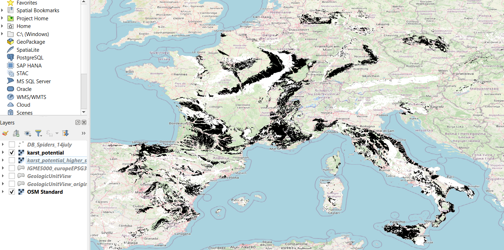
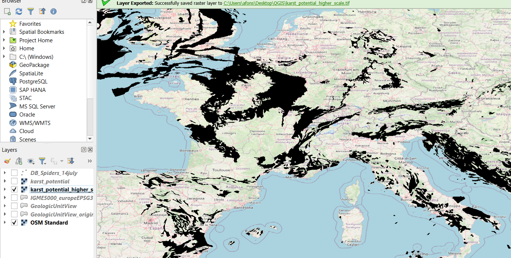

```{r setup, include=FALSE}
library(knitr)
knitr::opts_chunk$set(
  echo = TRUE,
  cache = FALSE,
  dpi = 900)
```

This script documents the workflow I used to prepare the predictor grids for modelling. It was originally created using *Rmarkdown* format.

This is evidently a large-scale study. Dividing the species in groups, each using different predictor variables, is good practice when modelling communities, but here it makes no sense to do so, as there's no *a priori* reason to believe different groups of subterranean spiders will have different drivers.


## Historical climate data

Overall, temperatures found in caves are extensively documented to be proportional to outside climate. This is because they are determined by the temperature of the water that percolates and flows inside them, which is itself dependent on surface temperature. This means mean annual temperature is the most important factor to determine cave temperature. There are, however, small differences with depth, due to the geothermal gradient [@mammola2018].

I will use the [CHELSA EUR11](https://chelsa-climate.org/high-resolution-climate-data-for-europe/) and [ClimateEU](https://www.nature.com/articles/s41597-020-00763-0) datasets, since they are Europe-specific and probably received more attention to regional detail in their making. They are both more recent than [WorldClim](https://www.worldclim.org/data/index.html). Both CHELSA EUR11 and Climate EU are not available for the islands, so I will integrate CHELSA Global. It shouldn't be a problem to have their climatic variables be determined by a different downscaling model, since mainland and islands are spatially disjoint, so blending downscaling models will not introduce artifacts.

I chose bioclimatic variables 1, 4, 12 and 15 -- both mean and variation of temperature and precipitation, since they're likely the most important drivers for subterranean species, and highly correlated with all the other bioclimatic variables. Regarding annual precipitation/bio12: even though, strictly, higher air temperature in caves increase its maximum moisture content, that effect is overshadowed by the decrease in precipitation associated with climate change, in places such as the Mediterranean. In these situations, caves will become drier.

```{r}
library(terra)
library(here)

# create vector with file names
cEU_file_names <- list.files(
  here("1.preparing_predictors", "climate_data","ClimateEU","historical_1981-2010","Normal_1981-2010_bioclim_tif_1km"), 
  "tif$", full.names=TRUE # the $ excludes aux-files
  ) 

# MAT	mean annual temperature (°C)
MAT <- rast( cEU_file_names[13] )

# MAP mean annual precipitation (mm)
MAP <- rast( cEU_file_names[12] )

# CRS, extent and resolution
MAT ; MAP
```

The raster is using Albers Equal Area Conic projection, which is adequate, since it conserves area and is therefore more indicated to calculate range changes; it also reasonably conserves shape and angles for high latitudes.

```{r, warning=FALSE, fig.width=9, fig.height=4.5}
# plot ClimateEU rasters of interest

par(mfrow = c(1,2), cex.main = 0.4)
plot( MAT , main = "MAT	mean annual temperature (°C)")
plot( MAP ,main = "MAP mean annual precipitation (mm)")

# means and ranges 

global(MAT, c('mean','min','max'), na.rm = TRUE)
global(MAP, c('mean','min','max'), na.rm = TRUE) 
```

```{r, warning=FALSE, fig.width=8, fig.height=8}
# boxplots and histograms of Climate climatic variables of interest

par(mfrow = c(2,2), cex.main = 0.4)

boxplot( MAT , main = "MAT mean annual temperature (°C)", col='orange')
boxplot( MAP, main = "MAP mean annual precipitation (mm)", col='lightblue')

hist( MAT , main = "MAT mean annual temperature (°C)", col='orange')
hist( MAP, main = "MAP mean annual precipitation (mm)", col='lightblue')
```

Note the plots are based on small samples of the dataset, but should give a general idea.

Now, to merge ClimateEU continental data with the CHELSA Global island data.

```{r}
# importing four bioclimatic variables with global extent (CHELSA V2 data)

bio1_g <- rast(here("1.preparing_predictors","climate_data","CHELSA_Global","historical_1981-2010","CHELSA_bio1_1981-2010_V.2.1.tif"))
bio4_g <- rast(here("1.preparing_predictors","climate_data","CHELSA_Global","historical_1981-2010","CHELSA_bio4_1981-2010_V.2.1.tif"))
bio12_g <- rast(here("1.preparing_predictors","climate_data","CHELSA_Global","historical_1981-2010","CHELSA_bio12_1981-2010_V.2.1.tif"))
bio15_g <- rast(here("1.preparing_predictors","climate_data","CHELSA_Global","historical_1981-2010","CHELSA_bio15_1981-2010_V.2.1.tif"))


# setting extent of the islands

i <- ext(-33, -12, 26, 41)


# cropping each global raster with said extent

bio1_i <- crop(bio1_g, i)
bio4_i <- crop(bio4_g, i)
bio12_i <- crop(bio12_g, i)
bio15_i <- crop(bio15_g, i)
```

Starting with mean annual temperature (MAT/Bio1):

```{r, eval = FALSE}
# reprojecting to same CRS as ClimateEU (Europe_Albers_Equal_Area_Conic)

crs <- crs( MAT )

bio1_i_reproj <- project( bio1_i, crs )

# the object just created still has slightly different resolution that what I want


# extending the MAT raster to the island region
# this must be done so i can resample bio1_i_reproj using MAT resolution in the next step
MAT_extended <- extend( MAT, bio1_i_reproj)


# resample bio1_i_reproj using MAT resolution
bio1_i_resam <- resample(bio1_i_reproj, MAT_extended, method = "bilinear")


# changing layer names 
names(bio1_i_resam) <- "mean_annual_temperature"
names(MAT) <- "mean_annual_temperature"

# creating directory 
dir.create(here("1.preparing_predictors","climate_data","merged","historical"), recursive = TRUE, showWarnings = FALSE)

# merging continental temperature raster (from ClimateEU) with island temperature raster (cropped from CHELSA Global)
MAT_ALL <- mosaic( MAT, bio1_i_resam,
                   filename = here("1.preparing_predictors","climate_data","merged","historical","MAT.tif"), overwrite = TRUE )
```

```{r}
# re-declare MAT_ALL
MAT_ALL <- rast( here("1.preparing_predictors","climate_data","merged","historical","MAT.tif") )

# plotting final mean annual temperature map
plot(MAT_ALL)
```

Summing up, this MAT_all variable is the MAT variable for continental Europe (from ClimateEU) merged with the equivalent variable (bio1) from cropped CHELSA Global for the islands. The latter was reprojected and resampled to the CRS and resolution of the former, using bilinear interpolation.

Repeating the same process for total annual precipitation (MAP/Bio12):

```{r, eval = FALSE}
# reprojecting to same CRS as ClimateEU (Europe_Albers_Equal_Area_Conic)

crs <- crs( MAP )

bio12_i_reproj <- project( bio12_i, crs )

# the object just created still has slightly different resolution that what I want


# extending the MAP raster to the island region
# this must be done so i can resample bio12_i_reproj using MAP resolution in the next step
MAP_extended <- extend( MAP, bio12_i_reproj)


# resample bio12_i_reproj using MAP resolution
bio12_i_resam <- resample(bio12_i_reproj, MAP_extended, method = "bilinear")


# changing layer names
names( MAP ) <- "total_annual_precipitation"
names( bio12_i_resam ) <- "total_annual_precipitation"


# merging continental precipitation raster (from ClimateEU) with island precipitation raster (cropped from CHELSA Global)
MAP_ALL <- mosaic( MAP, bio12_i_resam,
                   filename = here("1.preparing_predictors","climate_data","merged","historical","MAP.tif"), overwrite = TRUE )
```

```{r}
# re-declare MAP_ALL
MAP_ALL <- rast( here("1.preparing_predictors","climate_data","merged","historical","MAP.tif") )

# plotting final total annual precipitation map
plot(MAP_ALL)
```

Unfortunately, temperature seasonality from ClimateEU is defined differently than temperature SD from Bioclim or CHELSA, so I can't directly merge those layers. I also can't derive one of the variables from others, since ClimateEU splits the year in seasons and the other models split the year in quarters or months. Similarly, ClimateEU has no precipitation seasonality variable. I will obtain temperature SD (bio4) and precipitation seasonality (bio15) for ClimateEU data.

```{r, eval = FALSE}
library(dismo)

# create vectors with file names, dividing precipitation from Tmin and Tmax

Prec_monthly_file_names <- list.files(
  here("1.preparing_predictors","climate_data","ClimateEU","historical_1981-2010","Normal_1981_2010_monthly_tif_1km"),
  "Prec", full.names=TRUE
  )

Tmin_monthly_file_names <- list.files(
  here("1.preparing_predictors","climate_data","ClimateEU","historical_1981-2010","Normal_1981_2010_monthly_tif_1km"),
  "Tmin", full.names=TRUE
  )

Tmax_monthly_file_names <- list.files(
  here("1.preparing_predictors","climate_data","ClimateEU","historical_1981-2010","Normal_1981_2010_monthly_tif_1km"),
  "Tmax", full.names=TRUE
  )


# import stacks of rasters 

Prec_monthly_data <- stack(Prec_monthly_file_names)
Tmin_monthly_data <- stack(Tmin_monthly_file_names)
Tmax_monthly_data <- stack(Tmax_monthly_file_names)

# running biovars function to obtain bioclimatic variables from monthly data
# this is quite a heavy command... 

cEU_bioclim <- biovars( Prec_monthly_data, Tmin_monthly_data, Tmax_monthly_data)
# the resulting object is a RasterBrick

# saving it to disk
writeRaster( cEU_bioclim, here("1.preparing_predictors","climate_data","ClimateEU","historical_1981-2010","cEU_bioclim.tif"))

# re-importing from disk, in case already run part above
cEU_bioclim <- brick(here("1.preparing_predictors","climate_data","ClimateEU","historical_1981-2010","cEU_bioclim.tif"))

# seeing full result
plot(cEU_bioclim)


# the bio4 layer
bio4_cEU <- rast(cEU_bioclim[[4]])
plot( bio4_cEU )


# the bio15 layer
bio15_cEU <- rast(cEU_bioclim[[15]])
plot( bio15_cEU )
```

Now I also have bio4 (temperature SD \*100) and bio15 (precipitation seasonality) for the ClimateEU dataset. I then confirmed that it's in the same range of values as those provided by the WorldClim and CHELSA Global models.

```{r, eval = FALSE}
# reprojecting to same CRS as ClimateEU (Europe_Albers_Equal_Area_Conic)

crs <- crs( bio4_cEU )

bio4_i_reproj <- project( bio4_i, crs )
bio15_i_reproj <- project( bio15_i, crs )

# the objects just created still has slightly different resolution that what I want


# extending the ClimateEU rasters to the island region
# this must be done so i can resample bio4/15_i_reproj using ClimateEU resolution in the next step
bio4_cEU_extended <- extend( bio4_cEU , bio4_i_reproj)
bio15_cEU_extended <- extend( bio15_cEU , bio15_i_reproj)


# resample bio4/15_i_reproj using ClimateEU resolution
bio4_i_resam <- resample(bio4_i_reproj, bio4_cEU_extended, method = "bilinear")
bio15_i_resam <- resample(bio15_i_reproj, bio15_cEU_extended, method = "bilinear")


# merging continental bio4/15 rasters (from ClimateEU) with island bio4/15 rasters (cropped from CHELSA Global)
bio4_ALL <- mosaic( bio4_cEU, bio4_i_resam,
                   filename = here("1.preparing_predictors","climate_data","merged","historical","bio4.tif"), overwrite = TRUE )
bio15_ALL <- mosaic( bio15_cEU, bio15_i_resam,
                   filename = here("1.preparing_predictors","climate_data","merged","historical","bio15.tif"), overwrite = TRUE )
```

```{r}
# re-declare bio4/15_ALL
bio4_ALL <- rast( here("1.preparing_predictors","climate_data","merged","historical","bio4.tif") )
bio15_ALL <- rast( here("1.preparing_predictors","climate_data","merged","historical","bio15.tif") )

# plotting final bio4/15 maps
plot(bio4_ALL)
plot(bio15_ALL)
```

I now have these 4 final climate data files -- each for one variable -- in a new directory of my project. For the sake of validating the process above, I will check if the bio1 and bio12 layers I computed from the monthly data are, in fact, equal to the equivalent MAT and MAP layers provided by ClimateEU.

```{r, eval = FALSE}

# converting rasterBrick layers to spatRaster

DIY_bio1 <- rast(cEU_bioclim[[1]])
DIY_bio12 <- rast(cEU_bioclim[[12]])


# comparing means and ranges 

global( c(MAT, DIY_bio1) , 
        c('mean','min','max'), na.rm = TRUE)

global( c(MAP, DIY_bio12),
        c('mean','min','max'), na.rm = TRUE) 
```


## Last glacial maximum data

Although there are many other variables that can account for past climate, this could be one of the most relevant in Europe [@mammola2018]. In this layer, higher positive values denote locations further away from the Last Glacial Maximum (LGM) margin, and negative values denote locations once covered by the LGM, lower values meaning they were deeper inside its extension.

```{r, eval = FALSE}
# import 
ice_dist <- rast(here("1.preparing_predictors","lgm_data","ice_distance_v2.tif")) 

# reprojecting to Europe_Albers_Equal_Area_Conic CRS
ice_dist_reproj <- project( ice_dist, crs, 
                            filename=here("1.preparing_predictors","lgm_data","ice_dist_reproj.tif"), overwrite = TRUE )

# resampling raster according to the climatic rasters' geometry
# note the resolution of the ice dist data is 10x coarser than the usual 1km, so this is kind of a disaggregating operation
ice_dist_resampled <- resample( ice_dist_reproj , MAT_ALL, 
          method = "near", threads = TRUE,
          filename=here("1.preparing_predictors","lgm_data","ice_dist_reproj_resampled.tif"), overwrite = TRUE  )
```

```{r}
# re-declare ice_dist_resampled
ice_dist_resampled <- rast( here("1.preparing_predictors","lgm_data","ice_dist_reproj_resampled.tif") )

# plotting
plot(ice_dist_resampled)
```

## Elevation data

From the global Digital Elevation Models available, I chose the 30m resolution [ASTER Global Digital Elevation Model V003](https://search.earthdata.nasa.gov/search/granules/collection-details?p=C1711961296-LPCLOUD&pg%5B0%5D%5Bv%5D=f&pg%5B0%5D%5Bgsk%5D=-start_date&q=GDEM) because:

- GLOBE2 / GTOPO30 is coarser and less precise;
- ETOPO1 is coarser;
- SRTM does not cover a part of northern Europe;
- ASTER-DEM covers all of Europe, is more recent, and lighter.

I downloaded tiles for most of continental Europe (excluding the far East), and then for the islands. Since it is divided into two thousand files, I will join them in a single object. I initially did the merging in a crude way (involving writing the file to R memory, then writing it to the system, then re-importing it) but now learned these high-level commands like *terra::mosaic()* can write files directly to the filesystem, without having to pass in R's memory.

```{r, eval=FALSE}

# create vector with file names
elev_file_names_cont <- list.files(here("1.preparing_predictors","elevation_data","most_of_europe","ASTGTM_003-20250925_122655"), 
                              "dem\\.tif$", full.names=TRUE) # the $ excludes aux-files

# using lapply to apply rast function to all files, and sprc to create a SpatRaster collection of them
elev_collection_cont <- sprc(lapply(elev_file_names_cont, rast))

# merging collection into single SpatRaster
elev_cont <- mosaic(elev_collection_cont,
                    filename=here("1.preparing_predictors","elevation_data","most_of_europe","merged_continental_elev_tiles.tif"), 
                    overwrite = TRUE)
```

Doing exactly the same for island elevation data:

```{r, eval=FALSE}

# create vector with file names
elev_file_names_is <- list.files(here("1.preparing_predictors","elevation_data","oceanic_islands","ASTGTM_003-20250925_123437"), 
                              "dem\\.tif$", full.names=TRUE) # the $ excludes aux-files

# using lapply to apply rast function to all files, and sprc to create a SpatRaster collection of them
elev_collection_is <- sprc(lapply(elev_file_names_is, rast))

# merging collection into single SpatRaster
elev_is <- mosaic(elev_collection_is,
                  filename=here("1.preparing_predictors","elevation_data","oceanic_islands","merged_island_elev_tiles.tif"), 
                  overwrite = TRUE)
```

Process both continental and island elevation rasters separately, and then join only the processed final product.

```{r, eval = FALSE}
# getting main crs

crs <- crs( MAT_ALL )


# reprojecting raw elevation rasters to Europe_Albers_Equal_Area_Conic CRS

elev_cont_reproj <- project( elev_cont, crs, method = "near",
                             filename=here("1.preparing_predictors","elevation_data","most_of_europe","continental_elev_reproj.tif"), 
                             overwrite = TRUE) 

elev_is_reproj <- project( elev_is, crs, method = "near",
                           filename=here("1.preparing_predictors","elevation_data","oceanic_islands","islands_elev_reproj.tif"), 
                           overwrite = TRUE) 


# resampling reprojected raw elevation rasters according to the climatic rasters' geometry

mean_elev_cont <- resample( elev_cont_reproj , MAT_ALL, 
          method = "average", threads=TRUE, 
          filename=here("1.preparing_predictors","elevation_data","most_of_europe","continental_mean_elev.tif"), overwrite = TRUE  ) 

mean_elev_is <- resample( elev_is_reproj , MAT_ALL,
          method = "average", threads=TRUE, 
          filename=here("1.preparing_predictors","elevation_data","oceanic_islands","islands_mean_elev.tif"), overwrite = TRUE  )


# changing variable names inside spatRaster files

varnames(mean_elev_cont) <- "mean_elevation" 
names(mean_elev_cont) <- "mean_elevation"

varnames(mean_elev_is) <- "mean_elevation"
names(mean_elev_is) <- "mean_elevation"


# checking results
mean_elev_cont
plot(mean_elev_cont)
mean_elev_is
plot(mean_elev_is) 

# merging continental and island mean elevation rasters
mean_elev_corrected <- mosaic( mean_elev_cont, mean_elev_is,
                      filename=here("1.preparing_predictors","elevation_data","mean_elevation_corrected.tif"), 
                      overwrite = TRUE)
```

In the reprojected and resampled island data, the extent ends up being larger than it needs to be, probably because I resampled to MAT_ALL geometry, which is continent+islands, but this should not matter once I merge them.

```{r}
# re-declaring
mean_elev_corrected <- rast(here("1.preparing_predictors","elevation_data","mean_elevation_corrected.tif"))

# inspecting and plotting 
mean_elev_corrected
plot(mean_elev_corrected)
```

Regarding topographical heterogeneity, which is probably an important driver: theoretically, a more porous rock (e.g., more developed karst) should mean more habitat availability [@christman2016], although habitat availability might not be a limiting factor to subterranean fauna in all cases.

Usually, bigger pore size and topographic heterogeneity associate with wider distributions [@mammola2018]. Landscape rugosity might be a consequence of extensive erosion and karst age, just as fissure enlargement is, in the sense that one correlates with the other, not necessarily causing it. Also, more topographical heterogeneity may associate with more extensive Shallow Subterranean Habitat (SSH), particularly *Milieu Souterrain Superficiel* (MSS).

To quantify landscape rugosity, the simplest option would be simply calculating elevation range for each cell, but other measures such as SD of elevation, Topographic Position Index (TPI) or Terrain Ruggedness Index (TRI) should be better predictors.

TRI is calculated for each cell, usually by comparison to the other 8 cells around (3x3). I have a very fine 30m x 30m resolution DTM for the study area, but the original TRI article applied it to a 1km x 1km grid. It is unclear what scale I the command should be run on. If I run it at the finest possible scale (30m), and then obtain the mean for each 1km cell, the index should capture more information, so each 1km cell TRI value also captures small-scale topographical heterogeneity. Small- and large-scale TRI are probably very correlated anyway.

I tried calculating it in R using spatialEco, but it was very slow. In QGIS the operation took a few minutes. I used the standard TRI command (algorithm ID: gdal:triterrainruggednessindex) on the elev_cont and elev_is rasters.

```{r, eval = FALSE}
# importing QGIS 30m x 30m TRI raster

TRI_is <- rast(here("1.preparing_predictors","elevation_data","oceanic_islands","islands_TRI.tif"))
TRI_cont <- rast(here("1.preparing_predictors","elevation_data","most_of_europe","continental_TRI.tif"))

plot(TRI_is)
plot(TRI_cont)


# resampling fine-scale TRI rasters according to the climatic rasters' geometry

mean_TRI_cont <- resample( TRI_cont , MAT_ALL, 
          method = "average", threads=TRUE, 
          filename=here("1.preparing_predictors","elevation_data","most_of_europe","continental_mean_TRI.tif"), overwrite = TRUE  ) 

mean_TRI_is <- resample( TRI_is , MAT_ALL,
          method = "average", threads=TRUE, 
          filename=here("1.preparing_predictors","elevation_data","oceanic_islands","islands_mean_TRI.tif"), overwrite = TRUE  )


# changing variable names

varnames(mean_TRI_cont) <- "mean_TRI"
names(mean_TRI_cont) <- "mean_TRI"

varnames(mean_TRI_is) <- "mean_TRI"
names(mean_TRI_is) <- "mean_TRI"


# checking results

mean_TRI_cont
plot(mean_TRI_cont)

mean_TRI_is
plot(mean_TRI_is) 


# merging continental and island mean TRI rasters

mean_TRI <- mosaic( mean_TRI_cont, mean_TRI_is,
                      filename=here("1.preparing_predictors","elevation_data","mean_TRI.tif"), 
                      overwrite = TRUE)


```

```{r}
# re-declare mean_TRI
mean_TRI <- rast(here("1.preparing_predictors","elevation_data","mean_TRI.tif"))

# inspecting and plotting 
mean_TRI
plot(mean_TRI)
```


## Soil data

Nutrients available underground percolate through soil and rock, so soil characteristics should be taken into account as drivers of subterranean fauna distributions [@mammola2018]. I used [SoilGrids](https://soilgrids.org/) to download maps of surface Soil Organic Carbon and Coarse Fragments. Due to the extent limit, I had to use three different files for each layer. I chose the depth option to be the deepest possible (200cm), since these zones should most closely reflect subterranean condition. Soil Organic Carbon is relevant because it might be a proxy of food availability for subterranean fauna, and Coarse Fragments could reflect how fractured the rock is and possibly MSS potential. Note the value ranges of both variables are slightly different from the original files. This is due to the bilinear interpolation of the *terra::project()* function.

```{r, eval = FALSE}
# importing files

# mean soil organic carbon

# create vector with file names
soc_file_names <- list.files(here("1.preparing_predictors","soil_data","soil_organic_carbon100-200"), 
                              "tif$", full.names=TRUE) # the $ excludes aux-files

# using lapply to apply rast function to all files, and sprc to create a SpatRaster collection of them
soc_collection <- sprc(lapply(soc_file_names, rast))

# merging collection into single SpatRaster
soc_merged <- mosaic(soc_collection,
                  filename=here("1.preparing_predictors","soil_data","soil_organic_carbon100-200","soc_merged.tif"), 
                  overwrite = TRUE)


# mean coarse fragments

# create vector with file names
coarse_file_names <- list.files(here("1.preparing_predictors","soil_data","coarse_fragments100-200"), 
                              "tif$", full.names=TRUE) # the $ excludes aux-files

# using lapply to apply rast function to all files, and sprc to create a SpatRaster collection of them
coarse_collection <- sprc(lapply(coarse_file_names, rast))

# merging collection into single SpatRaster
coarse_merged <- mosaic(coarse_collection,
                  filename=here("1.preparing_predictors","soil_data","coarse_fragments100-200","coarse_merged.tif"), 
                  overwrite = TRUE)


# reprojecting rasters to desired crs

soc_reproj <- project( soc_merged, crs, method = "bilinear")
coarse_reproj <- project( coarse_merged, crs, method = "bilinear")


# resampling fine-scale soil rasters according to the climatic rasters' geometry

soc_resampled <- resample( soc_reproj , MAT_ALL, 
          method = "average", threads = TRUE,
          filename=here("1.preparing_predictors","soil_data","soc_resampled.tif"), overwrite = TRUE  )

coarse_resampled <- resample( coarse_reproj , MAT_ALL, 
          method = "average", threads = TRUE,
          filename=here("1.preparing_predictors","soil_data","coarse_resampled.tif"), overwrite = TRUE  ) 


# changing layer names and write files

names(soc_resampled) <- "soil_organic_carbon"
names(coarse_resampled) <- "soil_coarse_fragments"

writeRaster(soc_resampled, here("1.preparing_predictors","soil_data","soc_resampled2.tif"), overwrite = TRUE)
writeRaster(coarse_resampled, here("1.preparing_predictors","soil_data","coarse_resampled2.tif"), overwrite = TRUE)
```

```{r}
# re-declare soil variables
soc_resampled <- rast(here("1.preparing_predictors","soil_data","soc_resampled2.tif"))
coarse_resampled <- rast(here("1.preparing_predictors","soil_data","coarse_resampled2.tif"))


# plotting
plot(soc_resampled, main = "Soil Organic Carbon")
plot(coarse_resampled, main = "Coarse Fragments")
```

## Lithology data

Carbonate bedrock extent is usually used as a proxy to subterranean habitat availability. Some researchers use distance to karst areas instead. These variables underestimate non-karst subterranean habitat [@mammola2018], but might still be relevant. The best geological map I found for Europe is [EGDI 1:1 Million pan-european Surface Geology](https://metadata.europe-geology.eu/record/basic/5f7db57f-6e84-4484-835f-706b0a010833). There's also [the 1:5 Million International Geological Map of Europe and Adjacent Areas (IGME5000)](https://data.europa.eu/data/datasets/9fd6624c-0aa7-46d4-9da3-955e558cd5f1?locale=en) but it was made at higher scale.

All of Europe is covered on the web version of the map, but, when downloaded, there's missing data for Switzerland and a big part of the Dinarics. Because of this, I will use the second higher-scale geological dataset to solve those gaps. For each geological dataset, I isolated the lithology vector layers and added a column to each attribute table called "karst potential". I then set rules that attributed a value of "2" for limestone areas (highly karstifyable), "1" for other less-kartifyable carbonate lithologies, and "0" for all other. I rasterized these layers based on this value.

{width="50%"}
Classification rules for better-scale map.


{width="50%"}
Classification rules for higher-scale map.


To validate the accuracy of the classification I used for the higher-scale map, I visually checked the similarity between the two resulting rasters in the regions where both were available. I considered it sufficient.

{width="50%"}
Resulting raster of better-scale map.


{width="50%"}
Resulting raster of higher-scale map.


I then merged the two rasters from different sources, giving priority to the better one when both values were available (default merge operations just average the two values). The QGIS workflow used was:

1. Rasterize the original map ("karst_potential") with single burn-in value 1, to obtain its extent, calling it "karst_potential_extent" ;

2. Use raster calculator with the condition

IF("karst_potential_extent\@1" = 1, "karst_potential\@1", "karst_potential_higher_scale\@1")

while specifying the spatial extent of the operation to be bigger than default, since using default will return Nan values for the second layer. The condition chooses the better-scale map when available (including for "0" and "no data" values). I later realized the R function *terra::cover()* might also work in this case.

```{r, eval = FALSE}
# importing and seeing the raster
karst_nodata <- rast(here("1.preparing_predictors","lithology_data","merged_potential_karst.tif"))

# changing "no data" values to 0 
karst_0 <- subst(karst_nodata, NA, 0)

# reprojecting to desired crs
karst_reproj <- project( karst_0, crs, method = "bilinear",
                         filename = here("1.preparing_predictors","lithology_data","potential_karst_reproj.tif"),
                         overwrite = TRUE)

# resampling fine-scale raster according to the climatic rasters' geometry
karst <- resample( karst_reproj , MAT_ALL, 
          method = "average", threads = TRUE,
          filename=here("1.preparing_predictors","lithology_data","potential_karst_resampled.tif"), overwrite = TRUE  )
```

This variable could be continuous or a factor: value "2" denotes highly karstifyable rock (e.g., pure limestone), "1" denotes less karstifyable rock (e.g., impure limestone), and "0" denotes non-karstifyable rock. Only a continuous variable type can be used for range bagging models. An alternative could be obtaining percent area of carbonate bedrock per cell, but that's not compatible with having two categories of karstifyable rock. There is some nonsense karst potential in the ocean but it won't affect further analysis.

```{r}
# re-declare karst potential variable
karst <- rast(here("1.preparing_predictors","lithology_data","potential_karst_resampled.tif"))

# inspecting and plotting
karst
plot(karst, main = "karst potential")
```


## Future climate data

Both theoretical models and empirical data indicate caves present high thermal inertia, which can provoke a temporal off-set of many decades in the warming of deep underground habitat [@mammola2018]. Usually, for surface species, SDM favours extreme values as predictors since they represent physiological limits, but, for subterranean habitats, the average temperature might make more sense [@mammola2018].


### Main data source: ClimateEU

[The dataset](https://sites.ualberta.ca/~ahamann/data/climateeu.html) only has future climate data available from one Global Circulation Model (GCM) ensemble. I downloaded the data for three SSP pathways, each for the 2050s and 2080s normal periods. To obtain bio4 and bio15, I will run the *dismo::biovars()* function for each scenario and year.

Mean annual temperature increase per SSP:
- SSP1-2.6: 1.5-2.0°C
- SSP2-4.5: 2.5-3.0°C
- SSP3-7.0: 3.5-4.0°C

Climate normals:
- 2020s: 2011-2040
- 2050s: 2041-2070
- 2080s: 2071-2100

```{r, eval=FALSE}
library(raster)

folder_names <- c( here("1.preparing_predictors","climate_data","ClimateEU","2050","ssp126","Ensemble8_ssp126_2041-2070_monthly_tif_1km"),
                   here("1.preparing_predictors","climate_data","ClimateEU","2080","ssp126","Ensemble8_ssp126_2071-2100_monthly_tif_1km"),
                   here("1.preparing_predictors","climate_data","ClimateEU","2050","ssp245","Ensemble8_ssp245_2041-2070_monthly_tif_1km"),
                   here("1.preparing_predictors","climate_data","ClimateEU","2050","ssp370","Ensemble8_ssp370_2041-2070_monthly_tif_1km"),
                   here("1.preparing_predictors","climate_data","ClimateEU","2080","ssp245","Ensemble8_ssp245_2071-2100_monthly_tif_1km"),
                   here("1.preparing_predictors","climate_data","ClimateEU","2080","ssp370","Ensemble8_ssp370_2071-2100_monthly_tif_1km"))
  
for ( i in folder_names ) {
  
  # create vectors with file names, dividing precipitation from Tmin and Tmax
  Prec_monthly_file_names <- list.files(i , "Prec", full.names=TRUE)
  Tmin_monthly_file_names <- list.files(i , "Tmin", full.names=TRUE)
  Tmax_monthly_file_names <- list.files(i , "Tmax", full.names=TRUE)

  # import stacks of rasters 
  Prec_monthly_data <- raster::stack(Prec_monthly_file_names)
  Tmin_monthly_data <- raster::stack(Tmin_monthly_file_names)
  Tmax_monthly_data <- raster::stack(Tmax_monthly_file_names)

  # running biovars function to obtain bioclimatic variables from monthly data
  cEU_bioclim <- dismo::biovars( Prec_monthly_data, Tmin_monthly_data, Tmax_monthly_data)
  # the resulting object is a RasterBrick
  
  # saving it to disk
  writeRaster( cEU_bioclim, 
               filename = here( dirname(i), "biovars_bricks.tif" ))
}

# importing bricks from disk, after running part above
cEU_bioclim_2050_126 <- brick( here("1.preparing_predictors","climate_data","ClimateEU","2050","ssp126","biovars_bricks.tif") )
cEU_bioclim_2080_126 <- brick( here("1.preparing_predictors","climate_data","ClimateEU","2080","ssp126","biovars_bricks.tif") )
cEU_bioclim_2050_245 <- brick( here("1.preparing_predictors","climate_data","ClimateEU","2050","ssp245","biovars_bricks.tif") )
cEU_bioclim_2050_370 <- brick( here("1.preparing_predictors","climate_data","ClimateEU","2050","ssp370","biovars_bricks.tif") )
cEU_bioclim_2080_245 <- brick( here("1.preparing_predictors","climate_data","ClimateEU","2080","ssp245","biovars_bricks.tif") )
cEU_bioclim_2080_370 <- brick( here("1.preparing_predictors","climate_data","ClimateEU","2080","ssp370","biovars_bricks.tif") )
  
# fetching layers of interest
bio4_cEU_2050_126 <- rast(cEU_bioclim_2050_126[[4]])
bio15_cEU_2050_126 <- rast(cEU_bioclim_2050_126[[15]])

bio4_cEU_2080_126 <- rast(cEU_bioclim_2080_126[[4]])
bio15_cEU_2080_126 <- rast(cEU_bioclim_2080_126[[15]])

bio4_cEU_2050_245 <- rast(cEU_bioclim_2050_245[[4]])
bio15_cEU_2050_245 <- rast(cEU_bioclim_2050_245[[15]])

bio4_cEU_2050_370 <- rast(cEU_bioclim_2050_370[[4]])
bio15_cEU_2050_370 <- rast(cEU_bioclim_2050_370[[15]])

bio4_cEU_2080_245 <- rast(cEU_bioclim_2080_245[[4]])
bio15_cEU_2080_245 <- rast(cEU_bioclim_2080_245[[15]])

bio4_cEU_2080_370 <- rast(cEU_bioclim_2080_370[[4]])
bio15_cEU_2080_370 <- rast(cEU_bioclim_2080_370[[15]])


# creating directories
dir.create(here("1.preparing_predictors","climate_data","ClimateEU","2050","ssp126","Ensemble8_ssp126_2041-2070_bioclim_tif_1km"), recursive = TRUE, showWarnings = FALSE)
dir.create(here("1.preparing_predictors","climate_data","ClimateEU","2080","ssp126","Ensemble8_ssp126_2071-2100_bioclim_tif_1km"), recursive = TRUE, showWarnings = FALSE)
dir.create(here("1.preparing_predictors","climate_data","ClimateEU","2050","ssp245","Ensemble8_ssp245_2041-2070_bioclim_tif_1km"), recursive = TRUE, showWarnings = FALSE)
dir.create(here("1.preparing_predictors","climate_data","ClimateEU","2050","ssp370","Ensemble8_ssp370_2041-2070_bioclim_tif_1km"), recursive = TRUE, showWarnings = FALSE)
dir.create(here("1.preparing_predictors","climate_data","ClimateEU","2080","ssp245","Ensemble8_ssp245_2071-2100_bioclim_tif_1km"), recursive = TRUE, showWarnings = FALSE)
dir.create(here("1.preparing_predictors","climate_data","ClimateEU","2080","ssp370","Ensemble8_ssp370_2071-2100_bioclim_tif_1km"), recursive = TRUE, showWarnings = FALSE)


# writing these layers to disk (the location matters for nested loops step after)
writeRaster( bio4_cEU_2050_126, here("1.preparing_predictors","climate_data","ClimateEU","2050","ssp126","Ensemble8_ssp126_2041-2070_bioclim_tif_1km","bio4.tif"), overwrite = TRUE )

writeRaster( bio15_cEU_2050_126, here("1.preparing_predictors","climate_data","ClimateEU","2050","ssp126","Ensemble8_ssp126_2041-2070_bioclim_tif_1km","bio15.tif"), overwrite = TRUE )

writeRaster( bio4_cEU_2080_126, here("1.preparing_predictors","climate_data","ClimateEU","2080","ssp126","Ensemble8_ssp126_2071-2100_bioclim_tif_1km","bio4.tif"), overwrite = TRUE )

writeRaster( bio15_cEU_2080_126, here("1.preparing_predictors","climate_data","ClimateEU","2080","ssp126","Ensemble8_ssp126_2071-2100_bioclim_tif_1km","bio15.tif"), overwrite = TRUE )

writeRaster( bio4_cEU_2050_245, here("1.preparing_predictors","climate_data","ClimateEU","2050","ssp245","Ensemble8_ssp245_2041-2070_bioclim_tif_1km","bio4.tif"), overwrite = TRUE )

writeRaster( bio15_cEU_2050_245, here("1.preparing_predictors","climate_data","ClimateEU","2050","ssp245","Ensemble8_ssp245_2041-2070_bioclim_tif_1km","bio15.tif"), overwrite = TRUE )

writeRaster( bio4_cEU_2050_370, here("1.preparing_predictors","climate_data","ClimateEU","2050","ssp370","Ensemble8_ssp370_2041-2070_bioclim_tif_1km","bio4.tif"), overwrite = TRUE )

writeRaster( bio15_cEU_2050_370, here("1.preparing_predictors","climate_data","ClimateEU","2050","ssp370","Ensemble8_ssp370_2041-2070_bioclim_tif_1km","bio15.tif"), overwrite = TRUE )

writeRaster( bio4_cEU_2080_245, here("1.preparing_predictors","climate_data","ClimateEU","2080","ssp245","Ensemble8_ssp245_2071-2100_bioclim_tif_1km","bio4.tif"), overwrite = TRUE )

writeRaster( bio15_cEU_2080_245, here("1.preparing_predictors","climate_data","ClimateEU","2080","ssp245","Ensemble8_ssp245_2071-2100_bioclim_tif_1km","bio15.tif"), overwrite = TRUE )

writeRaster( bio4_cEU_2080_370, here("1.preparing_predictors","climate_data","ClimateEU","2080","ssp370","Ensemble8_ssp370_2071-2100_bioclim_tif_1km","bio4.tif"), overwrite = TRUE)

writeRaster( bio15_cEU_2080_370, here("1.preparing_predictors","climate_data","ClimateEU","2080","ssp370","Ensemble8_ssp370_2071-2100_bioclim_tif_1km","bio15.tif"), overwrite = TRUE )
```


### Island data sources: CHELSA and WorldClim

[CHELSA](https://chelsa-climate.org/cmip6/) provides *bioclim* data for five models ("single" GCM, not ensembles), and assign priorities to them according to ISIMIP3b. From highest priority (1) to lowest (5):

GFDL-ESM4, UKESM1-0-LL, MPI-ESM1-2-HR, IPSL-CM6A-LR, MRI-ESM2-0

I will do the model averaging using the outputs of these five models, which are provided by CHELSA. Unfortunately, CHELSA does not provide projections for SSP2-4.5 (so I lack data only for that specific scenario, only for the islands). Since it is a small data gap, I will source it from WorldClim, using a single GCM. I chose the highest-ranked-priority GCM that is available, which is UKESM1-0-LL. Here climatology time windows are slightly offset, so I chose 2041--2060 WorldClim to merge with 2050s (2041--2070) ClimateEU and 2081--2100 WorldClim to merge with 2080s (2071--2100) ClimateEU. These are the combinations with most overlap.

```{r, eval = FALSE}

# defining lists which make up combinations that are our layers

vars <- list("bio1", "bio12", "bio4", "bio15")
periods <- list("2041-2070", "2071-2100")
scenarios <- list("ssp126", "ssp370") # ssp245 is not available from CHELSA


# setting (again) the extent of the islands and desired crs

i <- ext(-33, -12, 26, 41)
crs <- crs( MAT ) # could be any other layer from ClimateEU


# pipeline to process layers

for (v in vars) {
  for (p in periods) {
    for (s in scenarios) {
      
      
      # different name same thing
      
      if (v == "bio1") {
        V <- "MAT.tif$"
      } else if (v == "bio12") {
        V <- "MAP.tif$"
      } else if (v == "bio4") {
        V <- "bio4.tif$"
      } else if (v == "bio15") {
        V <- "bio15.tif$"
      } else {
        print("somethings wrong")
      }
      
      
      # fetching ClimateEU/continental layer, which is already an ensemble and in desired crs
      
      # finding directory where layer is
      directory <- list.files(here("1.preparing_predictors","climate_data","ClimateEU"), 
                        pattern = glob2rx( paste0("*", s , "_" , p , "_bioclim" , "*") ),  
                        recursive = TRUE, full.names = TRUE, include.dirs = TRUE)

      # importing layer
      continental_layer <- rast( list.files(directory , pattern = V,
                                            full.names = TRUE) )

      
      # finding and importing the five model outputs for the CHELSA V2 layer
      # paste0() creates a string that is taken as the pattern to look for in the directory
      # for example "*bio1_2041-2070*ssp126*"
      # * means wildcard
      # recursive=TRUE so it looks in subdirectories
      # full.names = TRUE so it gets the file name with the directory its in, otherwise rast() can't locate it after
      # sort() so raster layers are always in same order
      # the resulting object is a spatRaster with a layer for each model
      
      model_outputs <- rast( sort(list.files(here("1.preparing_predictors","climate_data","CHELSA_Global","future"), 
                                  pattern = glob2rx( paste0("*", v , "_" , p , "*" , s , "*") ),  
                                  recursive = TRUE, full.names = TRUE) ))
      
      
      # cropping global multi-layered spatRaster with said extent

      model_outputs_i <- crop(model_outputs , i)

      
      # running averaging function that takes in five layers and outputs one ensemble layer
      # the layers are sorted in alphabetical order: GFDL, IPSL, MPI, MRI, UKESM1 
      # and the priority order is: GFDL, UKESM1, MPI, IPSL, MRI
      # hence the order of the weighting factors, from 1.5 to 0.5
      
      add(model_outputs_i) <- weighted.mean( model_outputs_i , c(1.5, 0.75, 1, 0.5, 1.25), na.rm=TRUE)
      
      # model averaging done
      
      # reprojecting to same CRS as ClimateEU (Europe_Albers_Equal_Area_Conic)
      # model_outputs_i["lyr1"] extracts only the sixth layer (ensemble layer) from the raster
      
      ensemble_i_reproj <- project( model_outputs_i["lyr1"] , crs, method = "bilinear")
      
      
      # the objects just created still have slightly different resolution that what I want
      # extending the ClimateEU/continent rasters to the island region
      # this must be done so i can resample island rasters using ClimateEU resolution in the next step
      
      continental_layer_extended <- extend( continental_layer, ensemble_i_reproj)
      
      
      # resample island layer using continental layer resolution
      
      ensemble_i_resampled <- resample(ensemble_i_reproj, continental_layer_extended, method = "bilinear")


      # changing layer names 
      
      names(ensemble_i_resampled) <- v
      names(continental_layer) <- v
      
      # creating directory
      dir.create(here("1.preparing_predictors","climate_data","merged","future"), recursive = TRUE, showWarnings = FALSE)
      
      # merging continental raster (from ClimateEU) with island raster (cropped from CHELSA V2)
      
      merged <- mosaic( continental_layer, ensemble_i_resampled,
                        filename = here("1.preparing_predictors","climate_data","merged","future", paste0( p, "_", s, "_", v, ".tif" )), 
                        overwrite = TRUE )
      
      print( paste0( p, "_", s, "_", v, ".tif was done and exported"))
    }
  }
}


# ssp245 case

# importing projections from WorldClim
wc2050 <- rast(here("1.preparing_predictors","climate_data","WorldClim","wc2.1_30s_bioc_UKESM1-0-LL_ssp245_2041-2060.tif"))
wc2080 <- rast(here("1.preparing_predictors","climate_data","WorldClim","wc2.1_30s_bioc_UKESM1-0-LL_ssp245_2081-2100.tif"))

# subset bioclim variables of interest
wc2050 <- wc2050[[c(1,4,12,15)]]
wc2080 <- wc2080[[c(1,4,12,15)]]
  
# concatenating both files
wc_all <- c(wc2050, wc2080)

# cropping global multi-layered spatRaster with said extent
wc_all_i <- crop(wc_all , i)

# get continental equivalents, in same order
## names(wc_all_i)
continental_layers <- c(
  rast(here("1.preparing_predictors","climate_data","ClimateEU","2050","ssp245","Ensemble8_ssp245_2041-2070_bioclim_tif_1km","MAT.tif")),
  rast(here("1.preparing_predictors","climate_data","ClimateEU","2050","ssp245","Ensemble8_ssp245_2041-2070_bioclim_tif_1km","bio4.tif")),
  rast(here("1.preparing_predictors","climate_data","ClimateEU","2050","ssp245","Ensemble8_ssp245_2041-2070_bioclim_tif_1km","MAP.tif")),
  rast(here("1.preparing_predictors","climate_data","ClimateEU","2050","ssp245","Ensemble8_ssp245_2041-2070_bioclim_tif_1km","bio15.tif")),
  rast(here("1.preparing_predictors","climate_data","ClimateEU","2080","ssp245","Ensemble8_ssp245_2071-2100_bioclim_tif_1km","MAT.tif")),
  rast(here("1.preparing_predictors","climate_data","ClimateEU","2080","ssp245","Ensemble8_ssp245_2071-2100_bioclim_tif_1km","bio4.tif")),
  rast(here("1.preparing_predictors","climate_data","ClimateEU","2080","ssp245","Ensemble8_ssp245_2071-2100_bioclim_tif_1km","MAP.tif")),
  rast(here("1.preparing_predictors","climate_data","ClimateEU","2080","ssp245","Ensemble8_ssp245_2071-2100_bioclim_tif_1km","bio15.tif"))
)

s <- "ssp245"
for (i in 1:nlyr(wc_all_i) ){
  
  # get island layer
  is <- wc_all_i[[i]]
  
  # get continental layer
  continental_layer <- continental_layers[[i]]

  # reprojecting to same CRS as ClimateEU (Europe_Albers_Equal_Area_Conic)
  i_reproj <- project( is , crs, method = "bilinear")
      
  # the objects just created still have slightly different resolution that what I want
  # extending the ClimateEU/continent rasters to the island region
  # this must be done so i can resample island rasters using ClimateEU resolution in the next step
  continental_layer_extended <- extend( continental_layer, i_reproj)
      
  # resample island layer using continental layer resolution
  i_resampled <- resample(i_reproj, continental_layer_extended, method = "bilinear")

  # extract p string
  if ( grepl( "2041-2060", names(is) )) {p <- "2041-2070"} else
  if ( grepl( "2081-2100", names(is) )) {p <- "2071-2100"} else { print("somethings wrong") }
  
  # extract v string
  if ( grepl( "_1$", names(is) )) {v <- "bio1"} else 
  if ( grepl( "_12$", names(is) )) {v <- "bio12"} else 
  if ( grepl( "_4$", names(is) )) {v <- "bio4"} else 
  if ( grepl( "_15$", names(is) )) {v <- "bio15"} else {print("somethings wrong")}
  
  # changing layer names
  names(i_resampled) <- v
  names(continental_layer) <- v

  # merging continental raster (from ClimateEU) with island raster
  merged <- mosaic( continental_layer, i_resampled,
                    filename = here("1.preparing_predictors","climate_data","merged","future", paste0( p, "_", s, "_", v, ".tif" )), 
                    overwrite = TRUE )
      
  print( paste0( p, "_", s, "_", v, ".tif was done and exported"))
}
```

```{r}
# as an example of the process above:
# visualizing the five models' outputs for a variable and the resulting ensemble raster
# the first five are the independent model outputs and the last is the ensemble/mean

bio1_2050_ssp126 <- rast( sort(list.files(here("1.preparing_predictors","climate_data","CHELSA_Global","future"), 
                                      pattern = glob2rx("*bio1_2041-2070*ssp126*"), 
                                      recursive = TRUE, full.names = TRUE) ))

i <- ext(-33, -12, 26, 41) # just to run fast
bio1_2050_ssp126_i <- crop(bio1_2050_ssp126 , i)

add(bio1_2050_ssp126_i) <- weighted.mean( bio1_2050_ssp126_i , c(1.5, 0.75, 1, 0.5, 1.25), na.rm=TRUE)

bio1_2050_ssp126_i
plot(bio1_2050_ssp126_i) 
boxplot(bio1_2050_ssp126_i) 
```

Notice how the minimum and maximum values are less extreme in the ensemble layer (last one).


## Final inspection of predictor layers

I compiled the sources, meaning and units of each predictor variable. I also classified them as static/dynamic in the future, and noted, for the dynamic ones, if future (extrapolated) layers are available, for future projections.

```{r, echo = FALSE}
source <- c("ClimateEU + CHELSAv2 + WorldClim",
            "ClimateEU + CHELSAv2 + WorldClim",
            "ClimateEU + CHELSAv2 + WorldClim",
            "ClimateEU + CHELSAv2 + WorldClim",
            "Mammola",
            "ASTER",
            "ASTER",
            "SoilGrids",
            "SoilGrids",
            "EGDI + IGME5000")

vars <- c( "MAT", 
           "MAP",
           "bio4",
           "bio15",
          "ice_dist",
          "elev", 
            "TRI",
            "soc",
            "coarse",
            "karst")

meaning <- c( "mean annual temperature (bio1)", 
           "mean total annual precipitation (bio12)",
           "temperature seasonality (temperature SD * 100)",
           "precipitation seasonality (the Coefficient of Variation is the standard deviation of the monthly precipitation estimates expressed as a percentage of the mean of those estimates (i.e. the annual mean)",
          "mean distance to LGM",
          "mean elevation", 
            "mean terrain ruggosity index",
            "mean soil organic carbon at 100-200cm",
            "mean soil coarse fragments at 100-200cm",
            "DIY karst potential index")

units <- c("ºC",
           "mm/year (same as) kg/m²/year",
           "ºC/100",
           "mm (same as) kg/m²",
           "m",
           "m",
           "no units",
           "dg/kg",
           "cm³/dm³",
           "no units")

in_the_future <- c("dynamic",
            "dynamic",
            "dynamic",
            "dynamic",
            "static",
            "static",
            "static",
            "static*",
            "static",
            "static")

available_for_future <- c("yes",
                          "yes",
                          "yes",
                          "yes",
                          "(yes)",
                          "(yes)",
                          "(yes)",
                          "(yes)",
                          "(yes)",
                          "(yes)")


# declaring dataframe

vars_explain <- data.frame( PrimarySource = source,
                            Variable = vars,
                            Meaning = meaning,
                            Units = units,
                            InTheFuture = in_the_future,
                            AvailableForFuture = available_for_future)

# fancy table

library(knitr)

kable( vars_explain, 
       row.names = FALSE)
```

\* Soil organic carbon is not exactly a static variable over time, but will be treated as such since its future variation is probably much inferior to that of other variables.

```{r, echo = FALSE}
# importing layers

MAT <- rast( here("1.preparing_predictors","climate_data","merged","historical","MAT.tif") ) # MAT/bio1 - mean annual temperature
MAP <- rast( here("1.preparing_predictors","climate_data","merged","historical","MAP.tif") ) # MAP/bio12 - mean annual precipitation
bio4 <- rast( here("1.preparing_predictors","climate_data","merged","historical","bio4.tif") ) # temperature seasonality 
bio15 <- rast( here("1.preparing_predictors","climate_data","merged","historical","bio15.tif") ) # precipitation seasonality
ice_dist <- rast( here("1.preparing_predictors","lgm_data","ice_dist_reproj_resampled.tif") ) # distance to LGM
elev <- rast( here("1.preparing_predictors","elevation_data","mean_elevation_corrected.tif") ) # elevation
TRI <- rast(here("1.preparing_predictors","elevation_data","mean_TRI.tif")) # terrain ruggosity index
soc <- rast(here("1.preparing_predictors","soil_data","soc_resampled2.tif")) # soil organic carbon
coarse <- rast(here("1.preparing_predictors","soil_data","coarse_resampled2.tif")) # soil coarse fragments
karst <- rast(here("1.preparing_predictors","lithology_data","potential_karst_resampled.tif")) # karst potential index


# building a table with stats of all present-period predictors

stats <- global( c(
            MAT,
            MAP,
            bio4,
            bio15,
           ice_dist, 
           elev,
           TRI,
           soc,
           coarse,
           karst), 
        c('min','mean','max'), na.rm=TRUE)

stats_with_names <- cbind(data.frame( Variable = vars, stats ) )


# fancy table

kable( stats_with_names, digits = 2,
       row.names = TRUE,
       col.names = c("Variable", "Minimum", "Mean", "Maximum"))
```

The maximum SOC value in my dataset is 4657, which is slightly larger than the 4471-maximum reported in the original website scale. However, I checked that my value is coherent with the raw data I downloaded, so it is likely just an imprecision on their end.

```{r}
# moving all the final layers to a folder called "final_predictors"

dir.create( here("1.preparing_predictors","final_predictors"), showWarnings = FALSE, recursive = TRUE)

files_to_copy <- c(
  here("1.preparing_predictors","lgm_data","ice_dist_reproj_resampled.tif"),
  here("1.preparing_predictors","elevation_data","mean_elevation_corrected.tif"),
  here("1.preparing_predictors","elevation_data","mean_TRI.tif"),
  here("1.preparing_predictors","soil_data","soc_resampled2.tif"),
  here("1.preparing_predictors","soil_data","coarse_resampled2.tif"),
  here("1.preparing_predictors","lithology_data","potential_karst_resampled.tif")
)

invisible(file.copy(
  from = files_to_copy,
  to = here("1.preparing_predictors","final_predictors", basename(files_to_copy)),
  overwrite = TRUE
))

climate_dest <- here("1.preparing_predictors","final_predictors", "climate")
dir.create(climate_dest, recursive = TRUE, showWarnings = FALSE)

invisible(file.copy(
  from = list.files(
    here("1.preparing_predictors","climate_data","merged"),
    full.names = TRUE,
    recursive = FALSE
  ),
  to = climate_dest,
  recursive = TRUE,
  overwrite = TRUE
))
```

I masked all rasters with a layer I created on QGIS, which should cover the study area (all data points) but excludes the ocean, so the values of the grids and their correlations obtained from now on are from the landmasses only (for example, the climate data had a large extent of ocean area containing the islands). To do the mask, I customized [EEA Administrative Boundaries](https://www.eea.europa.eu/en/datahub/datahubitem-view/94438969-2dd5-4ba3-b708-e4d29a8b7699?activeAccordion=1093408%2C1083739) with a 2km buffer to avoid clipping away pixels with climate data and records by the sea, which could happen during the reprojecting or resampling. I then used QGIS to confirm that the mask covers all terrestrial areas where records can be, in particular that it effectively covers the coastlines.

```{r, eval = FALSE, fig.width=9, fig.height=4.5}
MAT_ <- rast( here("1.preparing_predictors","final_predictors","climate","historical","MAT.tif") )
crs <- crs( MAT_ )

mask_raw <- rast(here("1.preparing_predictors","mask","study_area_mask_raster.tif"))

mask_reproj <- project( mask_raw, crs)

mask_resamp <- resample( mask_reproj , MAT_, 
          method = "average", threads = TRUE,
          filename=here("1.preparing_predictors","mask","study_area_mask_raster_resampled.tif"), overwrite = TRUE  )


# testing for MAT grid

MAT_masked <- mask( MAT_, mask_resamp)

par( mfrow = c(1,2) )
plot( MAT_ )
plot( MAT_masked )


# set up a folder with same structure as "final_predictors" called "final_predictors_masked"
dirs <- list.dirs(here("1.preparing_predictors","final_predictors"), recursive = TRUE, full.names = FALSE)
lapply(
  here("1.preparing_predictors","final_predictors_masked", dirs),
  dir.create,
  recursive = TRUE,
  showWarnings = FALSE
)

# copy all non-.tif files (these are aux files, that wont change)
files <- list.files(here("1.preparing_predictors","final_predictors"), recursive = TRUE, full.names = FALSE)
files <- files[!grepl("\\.tif$", files, ignore.case = TRUE)]
invisible(file.copy(
  from = here("1.preparing_predictors","final_predictors", files),
  to   = here("1.preparing_predictors","final_predictors_masked", files),
  overwrite = TRUE
))


# masking all grids in final_predictors folder

# getting paths of all grids
predictor_paths <- list.files(here("1.preparing_predictors","final_predictors"), pattern = ".tif$", 
                              recursive = TRUE, full.names = TRUE, include.dirs = FALSE)

# masking each grid and sending it to new folder
for (i in predictor_paths) {
  
  new_path <- sub("final_predictors" , "final_predictors_masked", i)
  
  mask( rast(i), mask_resamp,
        filename = new_path, overwrite = TRUE)
  
  print( paste0( i, " was done and exported"))
}
```

## References
